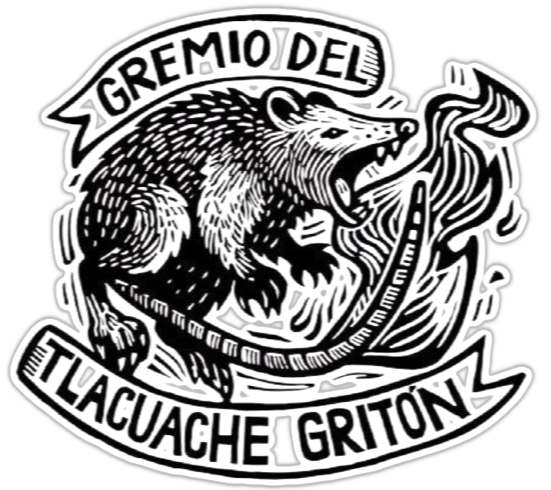

# ¡Bienvenides al Gremio del Tlacuache Gritón! 🔥

## Campañas Activas

Estos son documentos vivos, con informacion que se va descubriendo conforme las campañas avanzan y los jugadores hacen notas.

Están pensados para tener la informacion relevante para los jugadores centralizada, permitiendo a jugadores nuevos ponerse al día o refrescar la memoria de los veteranos. Estos documentos no deben tener adelantos de la campaña ni spoilers.

==- :bento: Livera &emsp; [!badge variant="info" text="DnD 5e"]
...Short Description

[Ir a la Campaña](/campaings/livera/index.md)

==- :zzz: Onírika &emsp; [!badge variant="info" text="DnD 5e"]
...Short Description

[Ir a la Campaña](/campaings/onirika/index.md)

==- :bangbang: Error 404 &emsp; [!badge variant="info" text="Mago: la Ascension"]
...Short Description

[Ir a la Campaña](/campaings/error_404/index.md)

===
